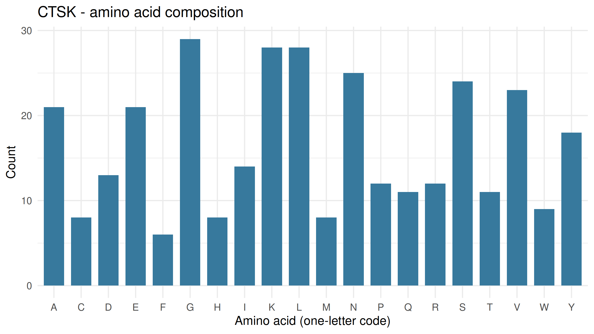
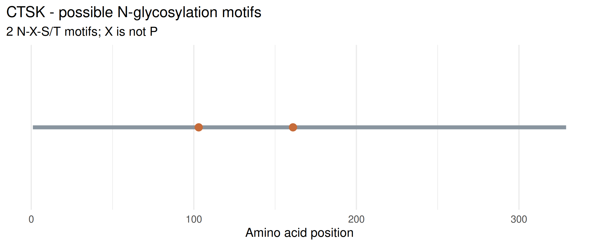

# Lysosomal Enzyme Sequence Analysis: CTSK (Cathepsin K)

* **Gene Symbol:** CTSK
* **Enzyme Name:** Cathepsin K
* **NCBI Protein Accession:** [NP_000387.1](https://www.ncbi.nlm.nih.gov/protein/NP_000387.1)
* **What it breaks down:** Extracellular matrix proteins, primarily **type I collagen**, type II collagen, and gelatin
* **Normal Cellular Function:** Cathepsin K is a lysosomal cysteine protease predominantly expressed in osteoclasts (bone-resorbing cells). It plays a vital role in bone remodeling, skeletal development, and the breakdown of bone collagen matrices

----
## Figures and Interpretation

### Figure 1: Amino Acid Composition

In Figure 1, we can observe the overall amino acid composition of the Cathepsin K protein across its 329-amino-acid sequence. The chart clearly maps out the frequency of all 20 standard amino acids, showing that certain residues—such as leucine, lysine, and glycine appear much more prominently than others. This distribution makes a lot of biological sense when we consider the protein's role as a lysosomal protease, since hydrophobic and charged residues work together to maintain structural stability and support its function within an acidic environment

### Figure 2: Potential N-Glycosylation Motifs

Figure 2 Shows the linear backbone of the Cathepsin K protein to show where potential N-glycosylation sites are hiding. The analysis flags two specific $N-X-S/T$ motifs (excluding proline) along the sequence, which are marked by the orange points. They show us where sugar chains *could* theoretically attach, but they don't give us hard proof that the protein is actually glycosylated inside a living cell. Even so, these predicted spots usually play a big role in helping the protein fold right and get routed safely to the lysosome

----
